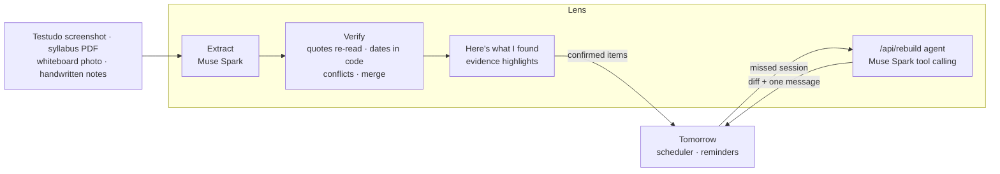

# tmrw-lens

Tomorrow Lens: photograph your week (schedules, syllabi, whiteboards) and get a verified, scheduled plan that rebuilds
when you miss something. Built on Meta's Muse Spark and SAM 3.1 for the Meta Global AI Developer Hackathon.

Built solo with AI coding assistance during the hackathon. See [HACKATHON.md](HACKATHON.md) for what was built when,
and [docs/PLAN.md](docs/PLAN.md) for the plan.



## Run it

Node 24 and pnpm 12.

```sh
pnpm install          # also enables the pre-commit hook (needs gitleaks: brew install gitleaks)
cp .env.example .env.local   # then set META_API_KEY
pnpm dev              # http://localhost:3000
pnpm test             # unit tests
pnpm smoke            # live calls to Meta Model API on synthetic fixtures (about 5 cents)
pnpm eval             # score the eval cases on recorded model readings (free, offline)
pnpm eval:live        # re-read every fixture with Meta Model API, then score (about 20 cents)
```

## Evals

Eleven cases over ten synthetic fixtures (`evals/cases/`, `fixtures/synthetic/`), two with deliberate conflicts
between sources. Latest run, Muse Spark 1.3 (`evals/results.json`):

|                  |                                                                                                   |
| ---------------- | ------------------------------------------------------------------------------------------------- |
| Invented dates   | **0** of 74 (every date traces to a quote and a code computation)                                 |
| Fully verified   | **73%** of everything found; the rest are real questions (conflicts, "in class" with no schedule) |
| Items found      | 68 of 68, dates right 54 of 54                                                                    |
| Conflicts caught | 4 of 4, right answer pre-selected 4 of 4, false conflicts 0                                       |

## License

Apache-2.0
