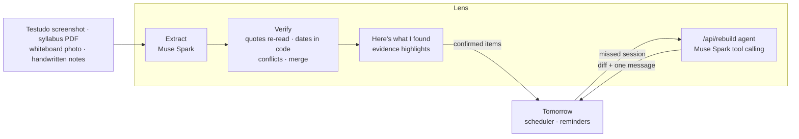

# tmrw-lens

Tomorrow Lens: photograph your week (schedules, syllabi, whiteboards) and get a verified, scheduled plan that rebuilds
when you miss something. Built on Meta's Muse Spark and SAM 3.1 for the Meta Global AI Developer Hackathon.

Built solo with AI coding assistance during the hackathon. See [HACKATHON.md](HACKATHON.md) for what was built when,
and [docs/PLAN.md](docs/PLAN.md) for the plan.



## Run it

Node 24 and pnpm 12.

```sh
pnpm install          # also enables the pre-commit hook (needs gitleaks: brew install gitleaks)
cp .env.example .env.local   # then set META_API_KEY
pnpm dev              # http://localhost:3000
pnpm test             # unit tests
pnpm smoke            # live calls to Meta Model API on synthetic fixtures (about 5 cents)
```

## License

Apache-2.0
