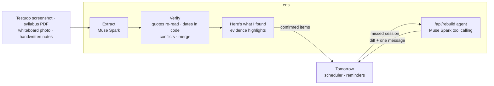

# tmrw-lens

Tomorrow Lens: photograph your week (schedules, syllabi, whiteboards) and get a verified, scheduled plan that rebuilds
when you miss something. Built on Meta's Muse Spark and SAM 3.1 for the Meta Global AI Developer Hackathon.

Built solo with AI coding assistance during the hackathon. See [HACKATHON.md](HACKATHON.md) for what was built when,
and [docs/PLAN.md](docs/PLAN.md) for the plan.



## Run it

Node 24 and pnpm 12.

```sh
pnpm install          # also enables the pre-commit hook (needs gitleaks: brew install gitleaks)
cp .env.example .env.local   # then set META_API_KEY
pnpm dev              # http://localhost:3000
pnpm test             # unit tests
pnpm smoke            # live calls to Meta Model API on synthetic fixtures (about 5 cents)
pnpm eval             # score the eval cases on recorded model readings (free, offline)
pnpm eval:live        # re-read fixtures whose recording is stale, then score (--force: all, about 22 cents)
pnpm eval:real        # the same on your own photos in local-inputs/ (git-ignored); prints numbers only
```

## Evals

Eleven cases over ten synthetic fixtures (`evals/cases/`, `fixtures/synthetic/`), two with deliberate conflicts
between sources. Each photo is read once, then second-read two ways: on SAM 3.1 object crops, and on plain box
crops, so the two columns differ only in SAM. Latest run, Muse Spark 1.3 and SAM 3.1 (`evals/results.json`):

|                                       | with SAM                                   | without SAM  |
| ------------------------------------- | ------------------------------------------ | ------------ |
| Invented dates                        | **0** of 159                               | **0** of 159 |
| Fully verified                        | **77%** (75 of 98)                         | **77%**      |
| Items found                           | 74 of 75                                   | 74 of 75     |
| Dates right                           | 65 of 65, after answers 4 of 4             | same         |
| Conflicts caught                      | 4 of 4, pre-selected right 4 of 4, false 0 | same         |
| Photo quotes in an object (highlight) | 23 of 23                                   | none         |
| Model cost per photo                  | $0.0185                                    | $0.0116      |

Every date traces to a quote and a code computation, including dates relative to another item ("the day after Quiz
3" moves when the Quiz 3 conflict is answered) and the end of every class recurrence. The rest of "fully verified"
are real questions (conflicts, "in class" with no schedule, a course a note doesn't name).

## License

Apache-2.0
