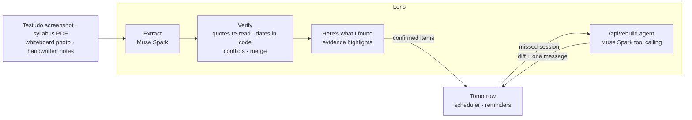

# tmrw-lens

Tomorrow Lens: photograph your week (schedules, syllabi, whiteboards) and get a verified, scheduled plan that rebuilds
when you miss something. Built on Meta's Muse Spark and SAM 3.1 for the Meta Global AI Developer Hackathon.

**Try it:** [lens.bettertmrw.app](https://lens.bettertmrw.app) (the sample week is free and instant; your own
photos are read live).

Built solo with AI coding assistance during the hackathon. See [HACKATHON.md](HACKATHON.md) for what was built when,
and [docs/PLAN.md](docs/PLAN.md) for the plan.



## Run it

Node 24 and pnpm 12.

```sh
pnpm install          # also enables the pre-commit hook (needs gitleaks: brew install gitleaks)
cp .env.example .env.local   # then set META_API_KEY
pnpm dev              # http://localhost:3000 (the sample week works without an API key)
pnpm test             # unit tests
pnpm test:visual      # every screen, light and dark, desktop and phone (after pnpm build; free)
pnpm smoke            # live calls to Meta Model API on synthetic fixtures (about 5 cents)
pnpm eval             # score the eval cases on recorded model readings (free, offline)
pnpm eval:live        # re-read fixtures whose recording is stale, then score (--force: all, about 22 cents)
pnpm eval:real        # the same on your own photos in local-inputs/ (git-ignored); prints numbers only
pnpm sample           # rebuild the app's sample week from the eval recordings (after eval:live)
pnpm eval:rebuild     # score the rebuild agent on recorded runs (free, offline)
pnpm eval:rebuild:live  # re-run stale rebuild cases with the model and the judge (--force: all, about 12 cents)
pnpm eval:extract     # score text-a-photo on recorded photo readings (free, offline)
pnpm eval:extract:live  # re-read photos whose recording is stale (about 5 cents)
```

How the app handles what people add: photos are shrunk and re-encoded in the browser (dropping EXIF, after reading the
capture time) and PDF pages are rendered there, so the server gets one small page per request and stores none of it.
Readings are cached for 24 hours by content hash, encrypted with a key derived from the image itself. Send relays
verified items to Tomorrow ([docs/IMPORT_CONTRACT.md](docs/IMPORT_CONTRACT.md)).

### Limits

Every model call is charged to someone, per UTC day. A call is one page or photo read, or one live rebuild; anything
answered from the cache is free and never counts.

| Who                                                                                    | Calls a day    | Dollars a day  |
| -------------------------------------------------------------------------------------- | -------------- | -------------- |
| A Tomorrow user (`user_ref` on `/api/rebuild` and `/api/extract`, hashed)              | 30             | $0.50          |
| Tomorrow requests without a `user_ref`, together (`tomorrow-unknown`)                  | only the brake | only the brake |
| A public visitor (a random id in a signed cookie, hashed)                              | 25             | $0.40          |
| One address, however many cookies it collects (hashed with the secret)                 | 75             | $1.50          |
| All public visitors together (`PUBLIC_DAILY_CAP_USD`)                                  |                | $5             |
| All Tomorrow users together (`TOMORROW_DAILY_CAP_USD`), separate from the public brake |                | $20            |

Past a limit, a visitor sees "come back tomorrow" (the sample week and the recorded rebuilds are always free); Tomorrow
gets `code: "user_limit"` (429) or `"global_limit"` (503) and uses its own code-only rebuild. The counters live in
Upstash for two days and hold only hashed ids; the cookie (`lens_v`) is a random id with no other use.

### Environment

Names only; values go in `.env.local` locally and in Vercel's settings when deployed. [.env.example](.env.example)
lists every one, with its default.

| Name                                                 | What it's for                                                                                                  |
| ---------------------------------------------------- | -------------------------------------------------------------------------------------------------------------- |
| `META_API_KEY`                                       | Meta Model API. Required for any model call                                                                    |
| `UPSTASH_REDIS_REST_URL`, `UPSTASH_REDIS_REST_TOKEN` | Limits, the reading cache, and review links. Required when deployed                                            |
| `LENS_REBUILD_SECRET`                                | Shared with Tomorrow for `/api/rebuild` and `/api/extract`; signs review links and the cookie, keys the hashes |
| `PUBLIC_DAILY_CAP_USD`                               | The public demo's brake (default: `DAILY_SPEND_CAP_USD` if set, else 5)                                        |
| `TOMORROW_DAILY_CAP_USD`                             | Tomorrow's users' brake (default 20)                                                                           |
| `DAILY_SPEND_CAP_USD`                                | Older name for `PUBLIC_DAILY_CAP_USD`, read only when that isn't set                                           |
| `TOMORROW_IMPORT_URL`                                | Where Send delivers confirmed items (default `https://bettertmrw.app/api/lens/import`)                         |
| `LENS_PUBLIC_URL`                                    | Where review links point (default `https://lens.bettertmrw.app`)                                               |
| `META_API_BASE_URL`, `MUSE_SPARK_MODEL`, `SAM_MODEL` | Optional overrides (Standard mode only)                                                                        |

## Evals

Eleven cases over ten synthetic fixtures (`evals/cases/`, `fixtures/synthetic/`), two with deliberate conflicts
between sources. Each photo is read once, then second-read two ways: on SAM 3.1 object crops, and on plain box
crops, so the two columns differ only in SAM. Latest run, Muse Spark 1.3 and SAM 3.1 (`evals/results.json`):

|                                       | with SAM                                   | without SAM  |
| ------------------------------------- | ------------------------------------------ | ------------ |
| Invented dates                        | **0** of 181                               | **0** of 181 |
| Fully verified                        | **83%** (82 of 99)                         | **83%**      |
| Items found                           | 75 of 75                                   | 75 of 75     |
| Classes right                         | 24 of 24                                   | 24 of 24     |
| Dates right                           | 65 of 65, after answers 4 of 4             | same         |
| Conflicts caught                      | 4 of 4, pre-selected right 4 of 4, false 0 | same         |
| Photo quotes in an object (highlight) | 23 of 23                                   | none         |
| Model cost per photo                  | $0.0208                                    | $0.0139      |

Every date traces to a quote and a code computation, including dates relative to another item ("the day after Quiz
3" moves when the Quiz 3 conflict is answered), the end of every class recurrence, and every class meeting skipped for a
break. The rest of "fully verified"
are real questions (conflicts, "in class" with no schedule, a course a note doesn't name).

### Rebuild

When a planned session passes undone, Tomorrow calls `POST /api/rebuild`
([docs/REBUILD_CONTRACT.md](docs/REBUILD_CONTRACT.md)). Muse Spark, with five tools (`get_day`, `find_open_time`,
`move_item`, `drop_item`, `propose_diff`), decides what moves or drops and why; code computes the free time, refuses
any move that doesn't fit, and writes the one message from the reasons ("Moved Calc practice to 9pm today because it's
still free after practice and before the quiz tomorrow morning. Nothing else changed."). Try it on the homepage under
**Try a missed session**: eleven recorded cases replay for free, and "Rebuild it live" runs Muse Spark on your own
reply.

Every recorded message was read and approved by the owner (human-reviewed, Nov 2), not only scored by the judge,
which is the same model as the agent. Every text fits one SMS segment (160 characters, plain ASCII), enforced by a
test. Eleven synthetic cases (`evals/rebuild/cases.ts`): making room, "too tired tonight", "practice until 9", sick today,
shortening to fit, no time left, a reply that tries to give orders, the clock change, partial. Latest run
(`evals/rebuild/results.json`):

|                                  | agent (reasoning effort low)   | code alone (fallback) |
| -------------------------------- | ------------------------------ | --------------------- |
| Rebuilds right                   | **11 of 11**                   | 5 of 11               |
| Invalid moves                    | **0**                          | 0                     |
| Unkind messages                  | **0**                          | 0                     |
| Judge score (Muse Spark, 1 to 5) | 5.0                            |                       |
| Model cost per rebuild           | $0.0072 (3.7 turns, about 5 s) | free                  |
| Tokens per call, cache hit rate  | 2692 in, 254 out; 83% cached   |                       |

### Text a photo

Tomorrow sends Lens the photos someone texts (`POST /api/extract`, [docs/EXTRACT_CONTRACT.md](docs/EXTRACT_CONTRACT.md)),
with the items it already has. One cheap call says what each photo is and whether it can be read; then it's read and
verified like any upload. Lens returns the new items (only verified ones are auto-applicable), changes to existing items
with their evidence ("whiteboard says Quiz 3 → Mon Nov 2"), never applied until the person answers, one question per
ambiguity, and a signed review link that lasts 24 hours. Four synthetic cases (`evals/extract/cases.ts`): a whiteboard
moving a syllabus quiz, a course site's to-do list (alone, and against items already in Tomorrow), and a blurry photo:

|                                           | text-a-photo        |
| ----------------------------------------- | ------------------- |
| Auto-applied and right (precision)        | **9 of 9**          |
| Gold items auto-applied (recall)          | **100%**            |
| Invented dates                            | **0** of 13         |
| Changes caught (applied before an answer) | 2 of 2 (0)          |
| Duplicates recognized                     | 2 of 2              |
| Model cost per photo                      | $0.0127 (3.3 calls) |

## License

Apache-2.0
