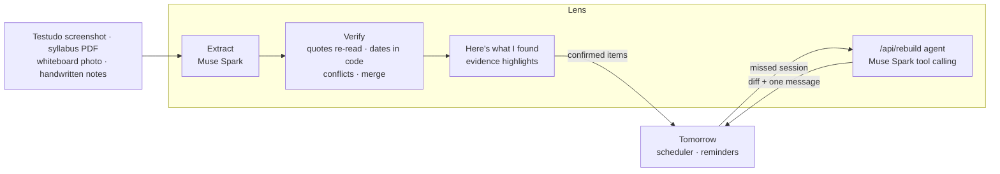

# tmrw-lens

Tomorrow Lens: photograph your week (schedules, syllabi, whiteboards) and get a verified, scheduled plan that rebuilds
when you miss something. Built on Meta's Muse Spark and SAM 3.1 for the Meta Global AI Developer Hackathon.

**Try it:** [lens.bettertmrw.app](https://lens.bettertmrw.app) (the sample week is free and instant; your own
photos are read live).

Built solo with AI coding assistance during the hackathon. See [HACKATHON.md](HACKATHON.md) for what was built when,
and [docs/PLAN.md](docs/PLAN.md) for the plan.



## Run it

Node 24 and pnpm 12.

```sh
pnpm install          # also enables the pre-commit hook (needs gitleaks: brew install gitleaks)
cp .env.example .env.local   # then set META_API_KEY
pnpm dev              # http://localhost:3000 (the sample week works without an API key)
pnpm test             # unit tests
pnpm smoke            # live calls to Meta Model API on synthetic fixtures (about 5 cents)
pnpm eval             # score the eval cases on recorded model readings (free, offline)
pnpm eval:live        # re-read fixtures whose recording is stale, then score (--force: all, about 22 cents)
pnpm eval:real        # the same on your own photos in local-inputs/ (git-ignored); prints numbers only
pnpm sample           # rebuild the app's sample week from the eval recordings (after eval:live)
pnpm eval:rebuild     # score the rebuild agent on recorded runs (free, offline)
pnpm eval:rebuild:live  # re-run stale rebuild cases with the model and the judge (--force: all, about 11 cents)
```

How the app handles what people add: photos are shrunk and re-encoded in the browser (dropping EXIF, after reading the
capture time) and PDF pages are rendered there, so the server gets one small page per request and stores none of it.
Readings are cached for 24 hours by content hash, encrypted with a key derived from the image itself. Send relays
verified items to Tomorrow ([docs/IMPORT_CONTRACT.md](docs/IMPORT_CONTRACT.md)).

## Evals

Eleven cases over ten synthetic fixtures (`evals/cases/`, `fixtures/synthetic/`), two with deliberate conflicts
between sources. Each photo is read once, then second-read two ways: on SAM 3.1 object crops, and on plain box
crops, so the two columns differ only in SAM. Latest run, Muse Spark 1.3 and SAM 3.1 (`evals/results.json`):

|                                       | with SAM                                   | without SAM  |
| ------------------------------------- | ------------------------------------------ | ------------ |
| Invented dates                        | **0** of 181                               | **0** of 181 |
| Fully verified                        | **82%** (81 of 99)                         | **82%**      |
| Items found                           | 75 of 75                                   | 75 of 75     |
| Classes right                         | 24 of 24                                   | 24 of 24     |
| Dates right                           | 65 of 65, after answers 4 of 4             | same         |
| Conflicts caught                      | 4 of 4, pre-selected right 4 of 4, false 0 | same         |
| Photo quotes in an object (highlight) | 23 of 23                                   | none         |
| Model cost per photo                  | $0.0210                                    | $0.0145      |

Every date traces to a quote and a code computation, including dates relative to another item ("the day after Quiz
3" moves when the Quiz 3 conflict is answered), the end of every class recurrence, and every class meeting skipped for a
break. The rest of "fully verified"
are real questions (conflicts, "in class" with no schedule, a course a note doesn't name).

### Rebuild

When a planned session passes undone, Tomorrow calls `POST /api/rebuild`
([docs/REBUILD_CONTRACT.md](docs/REBUILD_CONTRACT.md)). Muse Spark, with five tools (`get_day`, `find_open_time`,
`move_item`, `drop_item`, `propose_diff`), decides what moves or drops and why; code computes the free time, refuses
any move that doesn't fit, and writes the one message from the reasons ("Moved Calc practice to 9pm today because it's
still free after practice and before the quiz tomorrow morning. Nothing else changed."). Try it on the homepage under
**Try a missed session**: eleven recorded cases replay for free, and "Rebuild it live" runs Muse Spark on your own
reply.

Eleven synthetic cases (`evals/rebuild/cases.ts`): making room, "too tired tonight", "practice until 9", sick today,
shortening to fit, no time left, a reply that tries to give orders, the clock change, partial. Latest run
(`evals/rebuild/results.json`):

|                                  | agent (reasoning effort low)   | code alone (fallback) |
| -------------------------------- | ------------------------------ | --------------------- |
| Rebuilds right                   | **11 of 11**                   | 5 of 11               |
| Invalid moves                    | **0**                          | 0                     |
| Unkind messages                  | **0**                          | 0                     |
| Judge score (Muse Spark, 1 to 5) | 4.73                           |                       |
| Model cost per rebuild           | $0.0073 (3.7 turns, about 5 s) | free                  |
| Tokens per call, cache hit rate  | 2613 in, 249 out; 82% cached   |                       |

## License

Apache-2.0
