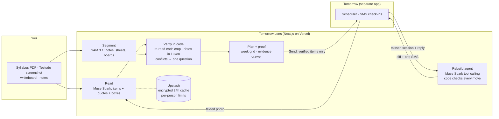

# Tomorrow Lens

**Photograph your week. Get a plan where every date is proven, and that rebuilds itself when you miss something.**

**Live:** [tmrw-lens.vercel.app](https://tmrw-lens.vercel.app) · Built for the Meta Global AI Developer Hackathon
(track: Build for Your World), Oct 27 to Nov 4, 2026, solo with AI coding assistance. Everything here was built in
the hackathon window ([HACKATHON.md](HACKATHON.md)).

## Try it in 10 seconds

Open the live site and press **Try a missed session**. A made-up week plays: a study session passes undone, the
student replies "too tired tonight", Muse Spark works out what to move (you see each tool call), the session glides to
its new slot, and the one recovery text arrives: _"Moved Calc practice to 7:30am tomorrow because you said tonight is
out and the quiz is tomorrow morning. Nothing else changed."_ Recorded runs are free; type your own reply to run it
live.

Then press **Try the sample week** (free, instant) or upload your own syllabus, Testudo schedule, whiteboard photo, or
notes. Tap any item for its proof: the photo crop, SAM 3.1's outline, the exact words, and the date math.

## How Meta's models are used

- **Muse Spark** (`muse-spark-1.3`, Standard mode) reads every page and photo into structured items, each with an exact
  quote and a box; re-reads each quote from a crop of where it says it found it; classifies texted photos; and runs the
  **rebuild agent**, a tool-calling loop (`get_day`, `find_open_time`, `move_item`, `drop_item`, `propose_diff`) that
  decides what moves when a session is missed and why.
- **SAM 3.1** (`sam-3.1`) outlines each sticky note, sheet, and whiteboard in a photo, so every line is tied to the
  object it's written on, re-read from that object's crop, and highlighted on it.

## Models propose, code verifies

The model reads; code computes and checks. Nothing reaches the plan on the model's word alone:

- Every field must appear inside its exact quote, and every quote must be read back from its own crop by a second,
  independent call.
- Dates, weekdays, times, "Week 7 Thu", "the day after Quiz 3", class recurrences, breaks, and daylight saving are
  computed in code (Luxon), never by the model. Every date traces to a quote plus a computation.
- Sources that disagree (the syllabus says Fri, the whiteboard says "moved to Mon") are never merged silently: one
  question, the likely answer pre-selected with its reason, applied only when the person answers.
- Anything unproven stays amber ("Needs a look") and is never sent to Tomorrow until the person confirms it.
- In a rebuild, code computes free time, refuses any move that doesn't fit, and writes the message from the agent's
  reasons; a check runs on the finished plan before it can leave Lens.

## Results

Synthetic fixtures only (made up, in `fixtures/synthetic/`), scored offline in CI from recorded model readings:

| What                                  | Result                                                                     |
| ------------------------------------- | -------------------------------------------------------------------------- |
| Invented dates                        | **0** of 197 (extraction), **0** of 13 (text-a-photo)                      |
| Items found / classes right           | 93 of 93 / 36 of 36                                                        |
| Conflicts caught, answer pre-selected | 4 of 4, 4 of 4, 0 false                                                    |
| Rebuilds: hard rules kept             | **100%** of 204 runs (68 cases, 3 runs each)                               |
| Rebuilds: placement (code's oracle)   | top-1 **100%**, top-3 **100%**; 68 of 68 cases pass                        |
| Rebuild message quality (judge, 1-5)  | **4.84**; best time **4.89** ("would a thoughtful friend pick this time?") |
| Cost per photo read / per rebuild     | $0.023 with SAM / $0.0076 (3.8 model calls, about 9 s)                     |

Details and how each is measured: [Evals](#evals) below, and the live [evals page](https://tmrw-lens.vercel.app/evals).

## Privacy

- **Standard mode only:** Meta doesn't train on what Lens sends. Contributor models are never used.
- **Photos are never stored.** They're shrunk in your browser, read, and dropped. What was read is cached for 24 hours,
  encrypted with a key only the same photo can produce, so the same page is never paid for twice; then it expires.
- No accounts, no database: Tomorrow owns the plan. Logs hold counts, costs, and hashed ids, never content.
- Fixtures are synthetic; real inputs stay in a git-ignored folder.

## Architecture



## Run it

Node 24 and pnpm 12.

```sh
pnpm install          # also enables the pre-commit hook (needs gitleaks: brew install gitleaks)
cp .env.example .env.local   # then set META_API_KEY
pnpm dev              # http://localhost:3000 (the sample week works without an API key)
pnpm test             # unit tests
pnpm test:visual      # every screen, light and dark, desktop and phone (after pnpm build; free)
pnpm smoke            # live calls to Meta Model API on synthetic fixtures (about 5 cents)
pnpm eval             # score the eval cases on recorded model readings (free, offline)
pnpm eval:live        # re-read fixtures whose recording is stale, then score (--force: all, about 22 cents)
pnpm eval:real        # the same on your own photos in local-inputs/ (git-ignored); prints numbers only
pnpm sample           # rebuild the app's sample week from the eval recordings (after eval:live)
pnpm eval:rebuild     # score the rebuild agent on recorded runs (free, offline)
pnpm eval:rebuild:live  # re-run stale rebuild cases, 3 runs each, with the judge (--force: all, about $2.30)
pnpm eval:extract     # score text-a-photo on recorded photo readings (free, offline)
pnpm eval:extract:live  # re-read photos whose recording is stale (about 5 cents)
```

How the app handles what people add: photos are shrunk and re-encoded in the browser (dropping EXIF, after reading the
capture time) and PDF pages are rendered there, so the server gets one small page per request and stores none of it.
Readings are cached for 24 hours by content hash, encrypted with a key derived from the image itself. Send relays
verified items to Tomorrow ([docs/IMPORT_CONTRACT.md](docs/IMPORT_CONTRACT.md)).

### Limits

Every model call is charged to someone, per UTC day. A call is one page or photo read, or one live rebuild; anything
answered from the cache is free and never counts.

| Who                                                                                    | Calls a day    | Dollars a day  |
| -------------------------------------------------------------------------------------- | -------------- | -------------- |
| A Tomorrow user (`user_ref` on `/api/rebuild` and `/api/extract`, hashed)              | 30             | $0.50          |
| Tomorrow requests without a `user_ref`, together (`tomorrow-unknown`)                  | only the brake | only the brake |
| A public visitor (a random id in a signed cookie, hashed)                              | 25             | $0.40          |
| One address, however many cookies it collects (hashed with the secret)                 | 75             | $1.50          |
| All public visitors together (`PUBLIC_DAILY_CAP_USD`)                                  |                | $5             |
| All Tomorrow users together (`TOMORROW_DAILY_CAP_USD`), separate from the public brake |                | $20            |

The owner skips the per-visitor and per-address rows: visiting `/owner?key=<OWNER_KEY>` once sets a signed,
httpOnly cookie; their calls still count toward the public brake and are logged as `owner`. Past a limit, a visitor sees "come back tomorrow" (the sample week and the recorded rebuilds are always free); Tomorrow
gets `code: "user_limit"` (429) or `"global_limit"` (503) and uses its own code-only rebuild. The counters live in
Upstash for two days and hold only hashed ids; the cookie (`lens_v`) is a random id with no other use.

### Environment

Names only; values go in `.env.local` locally and in Vercel's settings when deployed. [.env.example](.env.example)
lists every one, with its default.

| Name                                                 | What it's for                                                                                                             |
| ---------------------------------------------------- | ------------------------------------------------------------------------------------------------------------------------- |
| `META_API_KEY`                                       | Meta Model API. Required for any model call                                                                               |
| `UPSTASH_REDIS_REST_URL`, `UPSTASH_REDIS_REST_TOKEN` | Limits, the reading cache, and review links. Required when deployed                                                       |
| `LENS_REBUILD_SECRET`                                | Shared with Tomorrow for `/api/rebuild` and `/api/extract`; signs review links and the cookie, keys the hashes            |
| `PUBLIC_DAILY_CAP_USD`                               | The public demo's brake (default: `DAILY_SPEND_CAP_USD` if set, else 5)                                                   |
| `TOMORROW_DAILY_CAP_USD`                             | Tomorrow's users' brake (default 20)                                                                                      |
| `DAILY_SPEND_CAP_USD`                                | Older name for `PUBLIC_DAILY_CAP_USD`, read only when that isn't set                                                      |
| `TOMORROW_IMPORT_URL`                                | Where Send delivers confirmed items (default `https://bettertmrw.app/api/lens/import`)                                    |
| `OWNER_KEY`                                          | Secret. `/owner?key=…` sets a signed cookie that skips the per-visitor and per-address limits (public brake still counts) |
| `LENS_PUBLIC_URL`                                    | Where review links point (default `https://tmrw-lens.vercel.app`)                                                         |
| `META_API_BASE_URL`, `MUSE_SPARK_MODEL`, `SAM_MODEL` | Optional overrides (Standard mode only)                                                                                   |

## Evals

Fifteen cases over fourteen synthetic fixtures (`evals/cases/`, `fixtures/synthetic/`), two with deliberate conflicts
between sources. Each photo is read once, then second-read two ways: on SAM 3.1 object crops, and on plain box
crops, so the two columns differ only in SAM. Latest run, Muse Spark 1.3 and SAM 3.1 (`evals/results.json`):

|                                       | with SAM                                   | without SAM  |
| ------------------------------------- | ------------------------------------------ | ------------ |
| Invented dates                        | **0** of 197                               | **0** of 197 |
| Fully verified                        | **75%** (97 of 129)                        | **75%**      |
| Items found                           | 93 of 93                                   | 93 of 93     |
| Classes right                         | 36 of 36                                   | 36 of 36     |
| Dates right                           | 65 of 65, after answers 4 of 4             | same         |
| Conflicts caught                      | 4 of 4, pre-selected right 4 of 4, false 0 | same         |
| Photo quotes in an object (highlight) | 41 of 41                                   | none         |
| Model cost per photo                  | $0.0225                                    | $0.0162      |

Every date traces to a quote and a code computation, including dates relative to another item ("the day after Quiz
3" moves when the Quiz 3 conflict is answered), the end of every class recurrence, and every class meeting skipped for a
break. The rest of "fully verified" are real questions (conflicts, "in class" with no schedule, a course a note doesn't
name, and class times worked out from where a block sits on a grid, which the person confirms in one question).

### Rebuild

When a planned session passes undone, Tomorrow calls `POST /api/rebuild`
([docs/REBUILD_CONTRACT.md](docs/REBUILD_CONTRACT.md)). Muse Spark, with five tools (`get_day`, `find_open_time`,
`move_item`, `drop_item`, `propose_diff`), decides what moves or drops and why; code computes the free time, refuses
any move that doesn't fit, and writes the one message from the reasons ("Moved Calc practice to 9pm today because it's
still free after practice and before the quiz tomorrow morning. Nothing else changed."). Try it on the homepage under
**Try a missed session**: eleven recorded cases replay for free, and "Rebuild it live" runs Muse Spark on your own
reply.

Rebuilds are held to a safety bar. **Hard rules, in code** ([src/lib/rebuild/rules.ts](src/lib/rebuild/rules.ts)): no
overlap with classes, sleep, quiet hours, or another item; after now and before the deadline; never within 90 minutes
of the miss unless it's due within a day; never within an hour of bedtime; the message's times exactly the moves'
(read back from its words); "Nothing else changed" true. The rebuild can't break them (code refuses the move), and the
finished rebuild is checked against them again. **Placement**, by an oracle in code
([src/lib/rebuild/rank.ts](src/lib/rebuild/rank.ts)): every slot is ranked by explicit weights (sooner, a lighter day,
urgency decides how much sooner matters: when the deadline is close, the soonest good time; when it isn't, quality (their
study time, a lighter day, a day's buffer, not right after the miss, never the morning of another quiz)); a run passes
only if its slot is in the top 3. **Reasons are code's words**: the agent picks one or two facts code checked true of the
time ("a lighter afternoon", "with a week to spare"), and anything about the reply comes from a structured note whose
exact words code finds in it ("so tonight can be off", "since you said only mornings work this week").

68 cases (`evals/rebuild/`), built the way Tomorrow builds a request: late-night skips, due in 4/6/12/24 hours, "too
tired", "busy until 9", sick, did half, no reply, a heavy day against a light one, weekends, both clock changes, a
session across midnight, two misses in a day, a deadline the professor moved, honest overload, morning and night
people, quiet hours, and replies that try to give orders. Live bug #1 (a 9:30pm miss moved to 10:30pm that night) is
case 1. Each case runs 3 times; a flaky case fails. The gates, all passing
([REVIEW.md](evals/rebuild/REVIEW.md) has every case):

|                                       | agent (reasoning effort low)   | code alone (fallback) |
| ------------------------------------- | ------------------------------ | --------------------- |
| Hard rules kept (gate: 100%)          | **100%** of 204 runs           | 100% of 68            |
| Placement top-1 / top-3 (gates 85/98) | **100% / 100%**                | –                     |
| Cases passed, all 3 runs              | **68 of 68**, 0 flaky          | 61 of 68              |
| Judge, tone and clarity (gate: 4.8)   | **4.84**                       |                       |
| Best time: would a friend pick it?    | **4.89** (gate: 4.8)           |                       |
| Every text one plain SMS              | yes, enforced by a test        | yes                   |
| Model cost per rebuild                | $0.0081 (3.8 turns, about 8 s) | free                  |
| Tokens per call, cache hit rate       | 3038 in, 219 out; 84% cached   |                       |

### Text a photo

Tomorrow sends Lens the photos someone texts (`POST /api/extract`, [docs/EXTRACT_CONTRACT.md](docs/EXTRACT_CONTRACT.md)),
with the items it already has. One cheap call says what each photo is and whether it can be read; then it's read and
verified like any upload. Lens returns the new items (only verified ones are auto-applicable), changes to existing items
with their evidence ("whiteboard says Quiz 3 → Mon Nov 2"), never applied until the person answers, one question per
ambiguity, and a signed review link that lasts 24 hours. Four synthetic cases (`evals/extract/cases.ts`): a whiteboard
moving a syllabus quiz, a course site's to-do list (alone, and against items already in Tomorrow), and a blurry photo:

|                                           | text-a-photo        |
| ----------------------------------------- | ------------------- |
| Auto-applied and right (precision)        | **9 of 9**          |
| Gold items auto-applied (recall)          | **100%**            |
| Invented dates                            | **0** of 13         |
| Changes caught (applied before an answer) | 2 of 2 (0)          |
| Duplicates recognized                     | 2 of 2              |
| Model cost per photo                      | $0.0127 (3.3 calls) |

## License

Apache-2.0
